# Qwen Visual Skills

Eleven artifact-making weak-model wrapper skills for local LLMs, tuned on qwen3.8-27b via Hermes Agent. The hub also includes the experimental `qwen-prompt-architect` two-stage tool, whose mixed results are summarized below.

## Method

The loop is: Qwen generates from a one-sentence prompt → an AI critic scores and identifies confirmed defects → an AI rewriter makes a generic improvement → keep-best selects the highest-scoring version. The experiment ran 42 iterations. Scores are AI critic assessments, not benchmarks. See [method/LOOP.md](method/LOOP.md) and [method/LESSONS.md](method/LESSONS.md).

## Skills

Fork destinations and skill paths are taken from the publication results; all listed forks were confirmed. Poster images are illustrative output from the best-scoring recorded attempt.

| Skill | Fork / path | Best version | Score history (attempt: overall) | Example |
|---|---|---:|---|---|
| `qwen-diagram-design` | [vjranagit/diagram-design](https://github.com/vjranagit/diagram-design/tree/main/skills/qwen-diagram-design) | v1 (6.5/10) | 1: 6.5, 2: 5.0, 3: 5.0, 4: 4.2, 5: 5.3, 6: 5.0 | 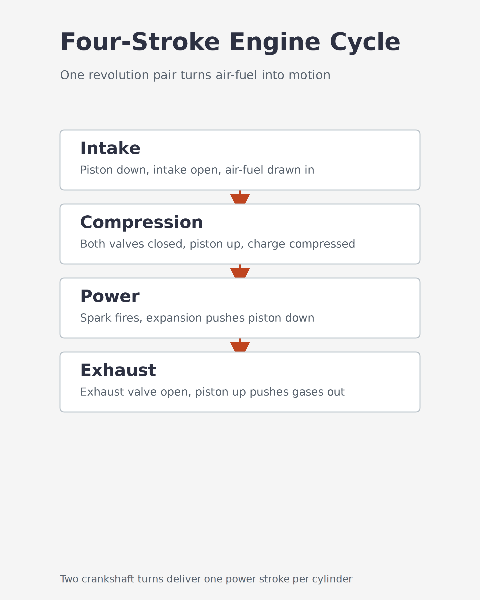 |
| `qwen-antv-infographic` | [vjranagit/Infographic](https://github.com/vjranagit/Infographic/tree/main/qwen-antv-infographic) | v3 (6.2/10) | 1: 5.2, 2: 5.8, 3: 6.2 | 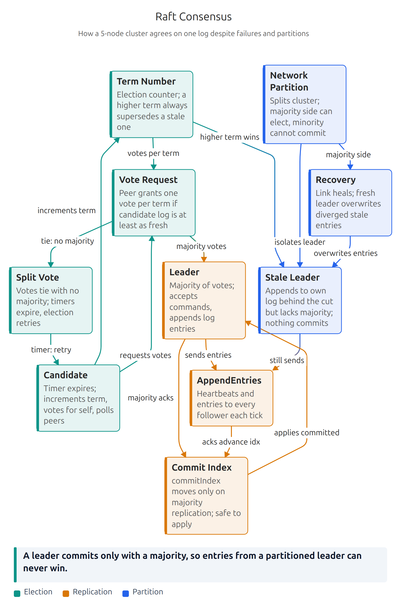 |
| `qwen-visual-explainer` | [vjranagit/visual-explainer](https://github.com/vjranagit/visual-explainer/tree/main/skills/qwen-visual-explainer) | v3 (5.5/10) | 1: 3.5, 2: 5.2, 3: 5.5 | 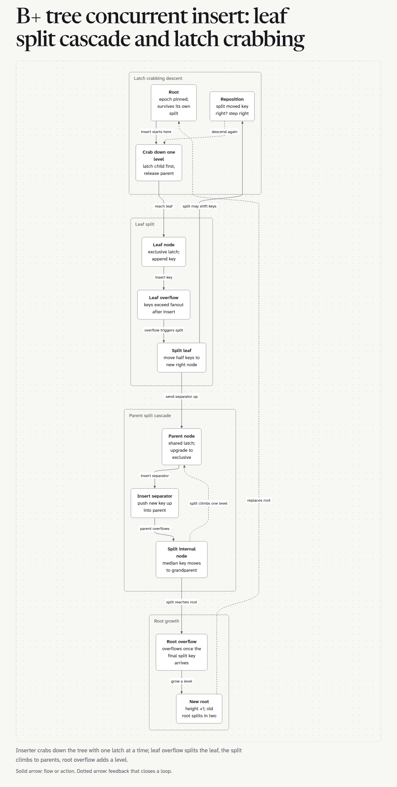 |
| `qwen-live-panel` | [vjranagit/live-panel-skill](https://github.com/vjranagit/live-panel-skill/tree/main/qwen-live-panel/) | v2 (6.0/10) | 1: 5.3, 2: 6.0, 3: 5.5 | 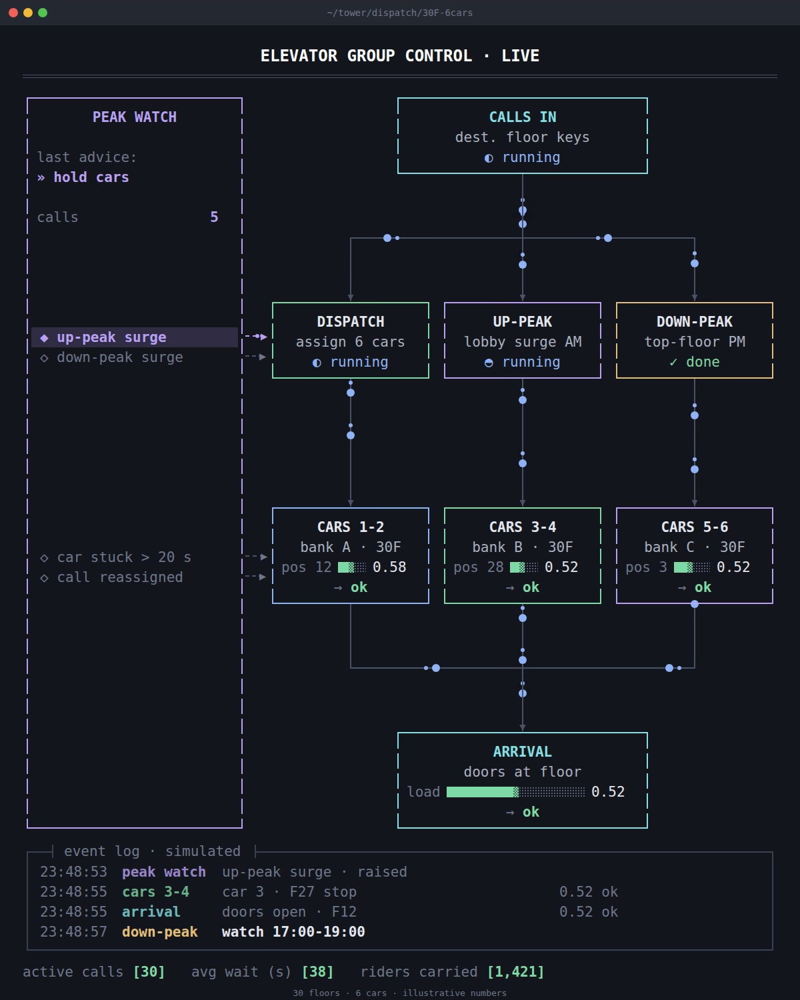 |
| `qwen-carousel` | [vjranagit/amigoscode-skills](https://github.com/vjranagit/amigoscode-skills/tree/main/skills/qwen-carousel) | v3 (6.3/10) | 1: 3.9, 2: 5.6, 3: 6.3 | 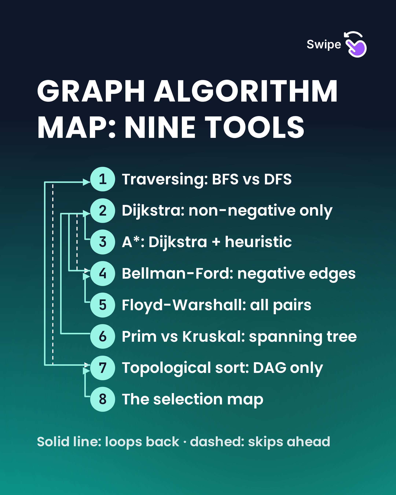 |
| `qwen-svg-infographic` | [vjranagit/skillstead](https://github.com/vjranagit/skillstead/tree/main/skills/qwen-svg-infographic) | v5 (6.2/10) | 1: 4.7, 2: 4.2, 3: 4.5, 4: 5.0, 5: 6.2, 6: 6.0 | 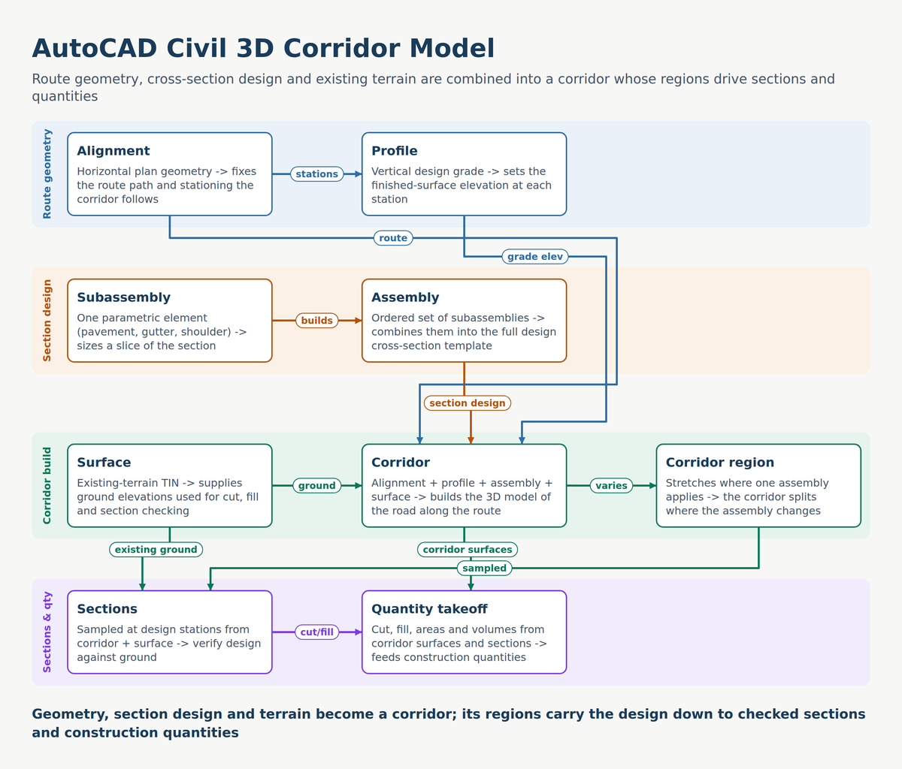 |
| `qwen-video-shotcraft` | [vjranagit/video-shotcraft](https://github.com/vjranagit/video-shotcraft/tree/main/qwen-video-shotcraft) | v3 (5.3/10) | 1: 4.5, 2: 5.0, 3: 5.3 | 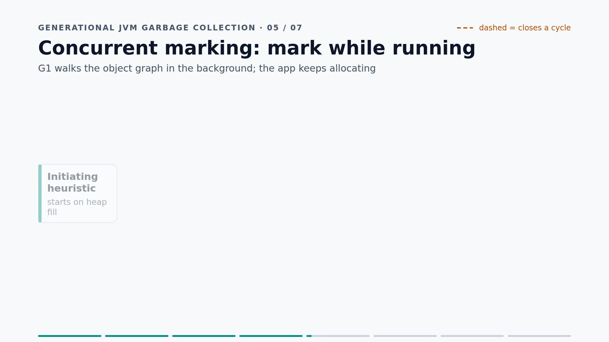 |
| `qwen-baoyu-diagram` | [vjranagit/baoyu-skills](https://github.com/vjranagit/baoyu-skills/tree/main/skills/qwen-baoyu-diagram) | v2 (8.0/10) | 1: 7.5, 2: 8.0, 3: 7.0, 4: 5.3, 5: 5.5, 6: 5.2 | 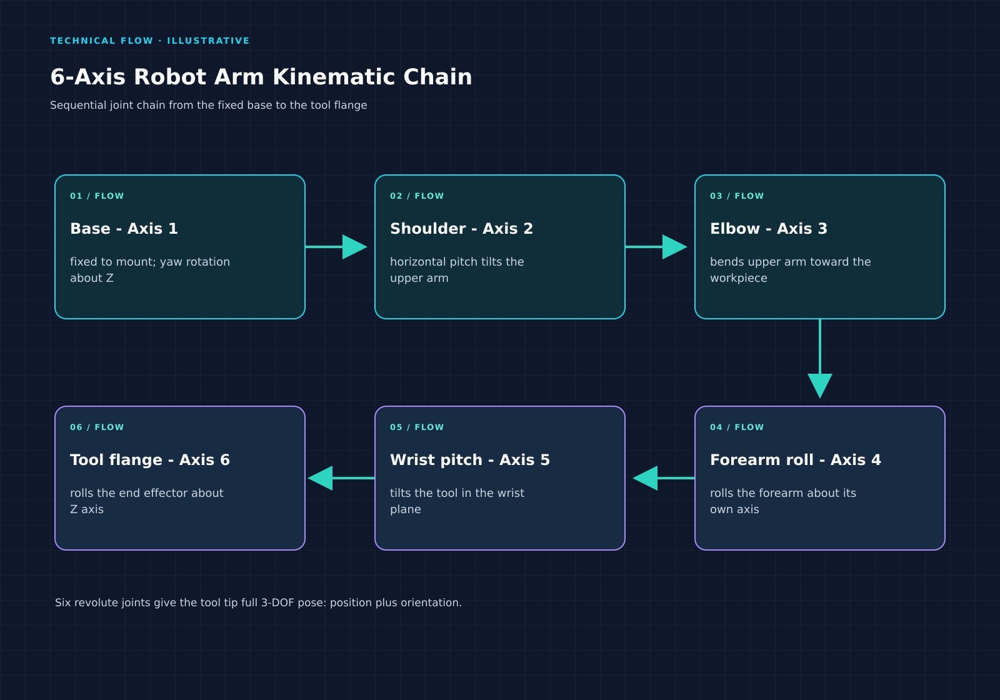 |
| `qwen-canvas-design` | [vjranagit/anthropic-skills](https://github.com/vjranagit/anthropic-skills/tree/main/skills/qwen-canvas-design) | v2 (6.7/10) | 1: 4.5, 2: 6.7, 3: 5.0 | 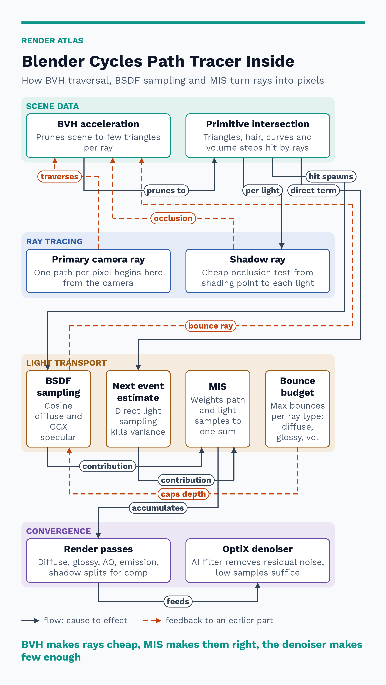 |
| `qwen-slack-gif-creator` | [vjranagit/anthropic-skills](https://github.com/vjranagit/anthropic-skills/tree/main/skills/qwen-slack-gif-creator) | v2 (5.8/10) | 1: 4.0, 2: 5.8, 3: 5.5 | 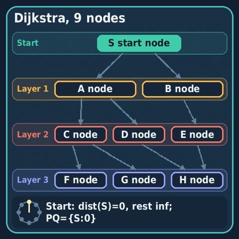 |
| `qwen-remotion` | Hub only; no upstream fork | v2 (5.7/10) | 1: 4.5, 2: 5.7, 3: 5.5 | 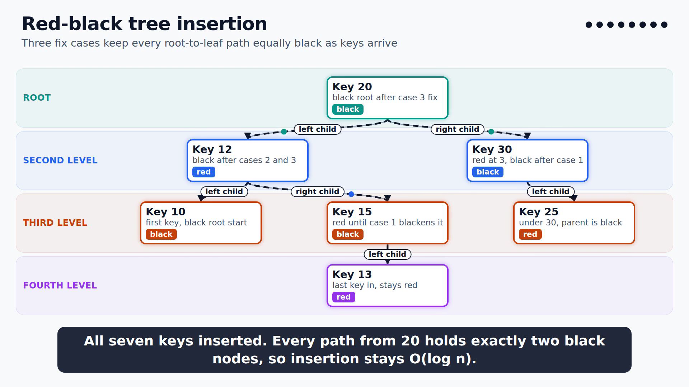 |

Full per-attempt score records are in [results/scores.csv](results/scores.csv).

## Two-stage: Qwen writes its own brief

The optional [`qwen-prompt-architect` skill](skills/qwen-prompt-architect/) asks Qwen to write a topic-specific brief, then hands that brief to a target skill in a fresh Hermes session. Across three iterations, this process did not beat direct baseline generation overall:

| Iteration | Topic | Two-stage mean | Baseline mean | Outcome |
|---:|---|---:|---:|---|
| 1 | Turbocharged diesel engine | 6.1 | 6.0 | Two-stage +0.1 |
| 2 | LSM tree storage engine | 6.3 | 6.5 | Baseline +0.2 |
| 3 | Blender geometry nodes | 3.9 | 6.1 | Baseline +2.2 |

In iteration 3, the carousel's stage 2 was truncated at the output-token limit and produced no artifact; its 1.0 is the rubric floor for pipeline failure, not a content score. A recurring lesson was that mandatory loop and branch requirements could make Qwen invent feedback paths when the topic did not support them. Treat the two-stage route as experimental, not a quality guarantee.

## Install

Clone the desired fork, then symlink its skill directory into the agent's skills folder. Run the skill's setup script if provided.

```sh
git clone <fork-repository-url>
ln -s "$PWD/<cloned-fork>/<skill-directory>" <agent-skills-folder>/<skill-name>
```

- **Hermes Agent:** link into `~/.hermes/skills/` (or the configured skills directory).
- **Claude Code:** link into `~/.claude/skills/`.
- **OpenCode:** link into `~/.config/opencode/skills/` (or your configured skills directory).
- **Codex:** link into `~/.codex/skills/`.

The Remotion wrapper lives only in this hub because its upstream skills repository has no license; only our wrapper files are included. Install its dependencies by running `skills/qwen-remotion/scripts/setup.sh`. Remotion has its own license and terms; companies should review those terms and determine whether a commercial license is required.

## Attribution and license

Hub-authored content is MIT licensed. Wrapped upstream skills retain their own licenses; see each skill's repository and license. No upstream files from remotion-dev/skills are included.
